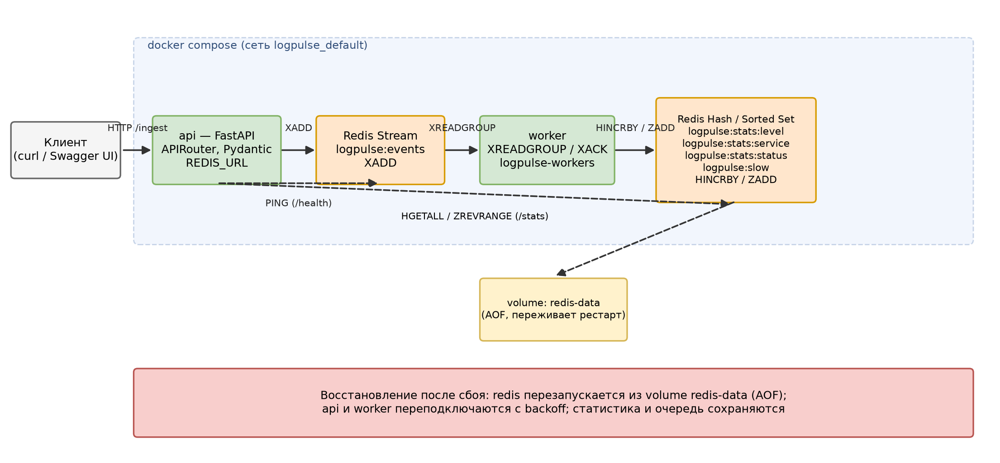

# LogPulse

Система для приёма и разбора логов сервисов. Принимает строки логов по HTTP,
проверяет их регулярками, валидные события кладёт в Redis Stream, отдельный
воркер их читает и считает статистику.

## Запуск

```bash
docker compose up --build -d
```

- http://127.0.0.1:8000 - приложение
- http://127.0.0.1:8000/docs - Swagger UI

Остановить:

```bash
docker compose down
```

Проверить, что всё поднялось (три контейнера, у api и redis статус healthy):

```bash
docker compose ps
```

Если порт 8000 занят, поднять на 8080:

Linux / macOS:

```bash
API_PORT=8080 docker compose up --build -d
```

Windows (PowerShell):

```powershell
$env:API_PORT="8080"; docker compose up --build -d
```

Важно: не использовать `docker compose down -v`, эта команда удаляет данные
Redis (volume).

## Проверка работы

Здоровье и Redis:

```bash
curl http://127.0.0.1:8000/health
```

Приём строки лога:

```bash
curl -X POST http://127.0.0.1:8000/ingest -H "Content-Type: application/json" -d "{\"lines\":[\"2026-10-20T12:34:56Z INFO auth 192.0.2.10 POST /api/login 200 43ms rid=ab12cd34\"]}"
```

Статистика и последние события:

```bash
curl http://127.0.0.1:8000/stats
curl "http://127.0.0.1:8000/events?limit=3"
```

Полный прогон по тестовому файлу:

```bash
python tools/smoke.py
```

## Как устроено

Клиент -> API (FastAPI) -> Redis Stream (logpulse:events) -> worker ->
Redis (Hash + Sorted Set). API ещё сам читает готовую статистику из Redis для /stats.



Схема в редактируемом виде: architecture.drawio (открывается на https://app.diagrams.net/).

## Состав компонентов

- app/parser.py - разбор строки логов регуляркой
- app/routers.py - маршруты /health, /ingest, /stats, /events
- app/models.py - Pydantic-модели
- app/stats.py - обновление и чтение статистики в Redis
- app/redis_client.py - клиент Redis и зависимость для FastAPI
- app/config.py - настройки и ключи
- worker.py - фоновый воркер
- data/sample.log - тестовые данные (45 корректных + 6 испорченных строк)
- tests/ - тесты pytest
- compose.yaml, Dockerfile - запуск в Docker

Linux / macOS:

```bash
python3 -m venv .venv
.venv/bin/pip install -r requirements-dev.txt
.venv/bin/uvicorn app.main:app --reload      # терминал 1
.venv/bin/python worker.py                   # терминал 2
```

Windows (PowerShell):

```powershell
python -m venv .venv
.venv\Scripts\pip install -r requirements-dev.txt
.venv\Scripts\uvicorn app.main:app --reload   # терминал 1
.venv\Scripts\python worker.py                # терминал 2
```

## Что хранится в Redis

| Ключ | Тип | Запись | Чтение |
| --- | --- | --- | --- |
| logpulse:events | Stream | XADD | XREADGROUP, XREVRANGE |
| logpulse:stats:level | Hash | HINCRBY | HGETALL |
| logpulse:stats:service | Hash | HINCRBY | HGETALL |
| logpulse:stats:status | Hash | HINCRBY | HGETALL |
| logpulse:slow | Sorted Set | ZADD | ZREVRANGE |

Медленным считается запрос с duration_ms >= 500 (меняется через SLOW_THRESHOLD_MS).

## Модели Pydantic

- IngestRequest - lines, от 1 до 100 строк, каждая 1-500 символов
- IngestResponse - accepted, rejected, errors
- StatsResponse - total, by_level, by_service, by_status, top_slow
- EventsResponse - count, events
- ErrorResponse - единый формат ошибок {"error": {"type", "message", "details"}}

Ошибки: 422 если неверная структура запроса, 503 если Redis недоступен.

## Тесты

```bash
pytest -q
docker compose exec api pytest -q
```

В тестах Redis подменяется на fakeredis, рабочие данные не портятся.

## Ограничения

- Если одно и то же сообщение придёт воркеру дважды, счётчики могут
  увеличиться дважды. В задании такие дубликаты допускаются как ограничение.
- Воркер один, шардирования нет.
